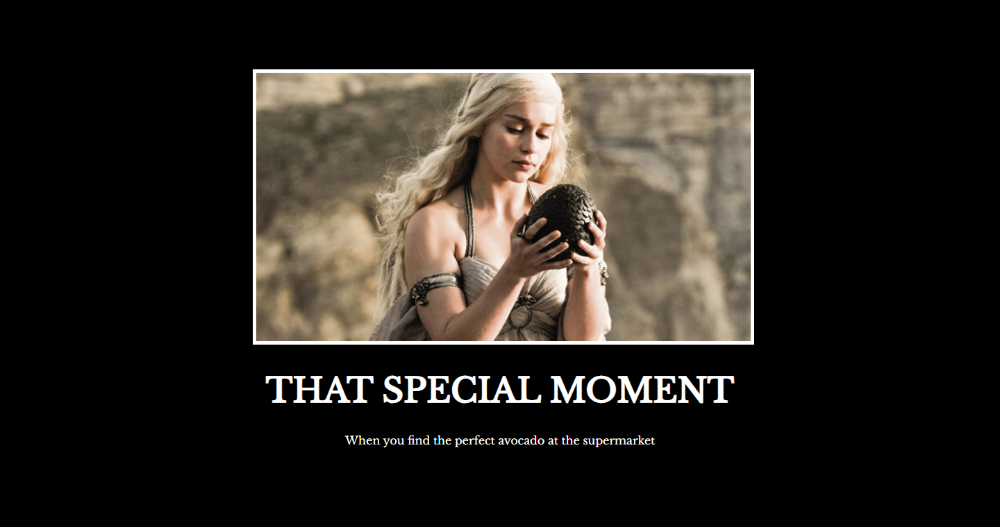

# Poster Motivasi

**Bahasa:** [English](../en/Home.md) · [Dansk](../da/Home.md) · Bahasa Malaysia

Laman web poster motivasi yang dibina dengan HTML dan CSS sahaja.



## Keperluan

1. `h1` menggunakan fon Libre Baskerville daripada Google Fonts.
2. Teks putih pada latar belakang hitam.
3. Imej dengan sempadan putih 5px.
4. Teks di tengah.
5. Satu `div` mengandungi `h1`, `p` dan `img`, dan diletakkan di tengah halaman.
6. `h1` ditukar kepada huruf besar melalui CSS, bukan dengan menaip semula.

## Cara ia berfungsi

### HTML

```html
<div class="poster">
  
  <h1>That Special Moment</h1>
  <p>When you find the perfect avocado at the supermarket</p>
</div>
```

Apabila imej dan teks berada dalam satu `div`, satu peraturan sahaja boleh
menetapkan saiz, kedudukan dan warna untuk kesemuanya.

### CSS

| Peraturan | Fungsi |
| --- | --- |
| `body { background-color: black; }` | Latar belakang halaman hitam. |
| `.poster { width: 50%; margin-left: 25%; }` | Lebar separuh halaman dengan 25% ruang kosong di kiri dan kanan, jadi poster berada di tengah secara mendatar. |
| `.poster { margin-top: 100px; }` | Ruang di atas poster. |
| `.poster { color: white; text-align: center; }` | Teks putih dan di tengah. |
| `.poster { font-family: "Libre Baskerville", serif; }` | Fon Google dengan fon sandaran. |
| `.motivation-img { width: 100%; border: 5px solid white; }` | Imej memenuhi `div` dan mendapat bingkai putih. |
| `h1 { text-transform: uppercase; }` | Huruf besar tanpa menaip semula tajuk. |

Fon Google dimuatkan dengan `<link>` dalam `<head>` fail `index.html`.

## Buat poster anda sendiri

1. Letakkan imej anda dalam `assets/images/`.
2. Kemas kini `src` dan `alt` pada `img`.
3. Tukar teks `h1` dan `p`.
4. Cuba-cuba: fon, warna, lebar sempadan, jarak.

## Jalankan

Buka `index.html` dalam pelayar. Sambungan internet diperlukan untuk memuatkan
fon.
